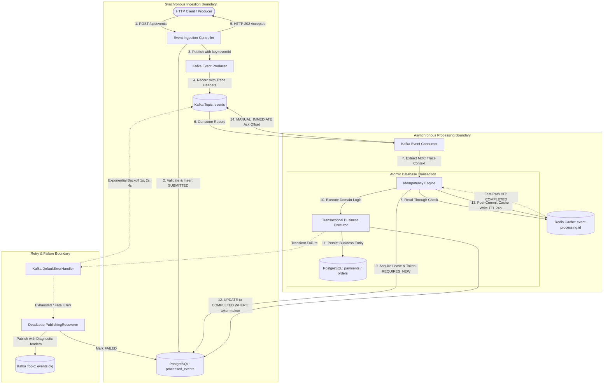
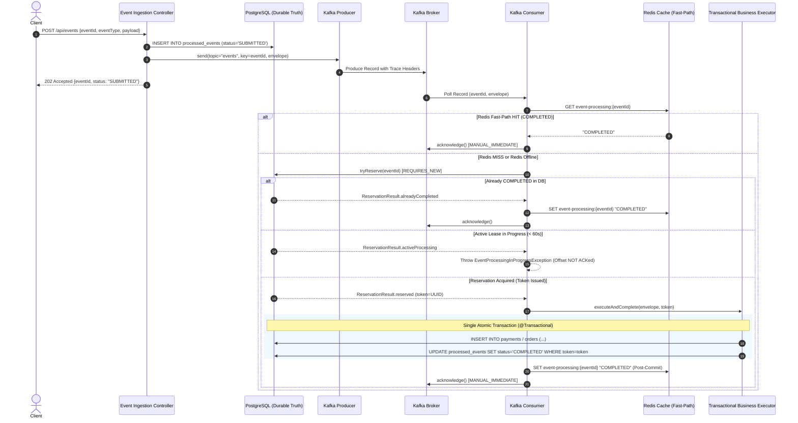

# FluxGuard — Distributed Idempotent Event Processing Engine

> **At-Least-Once Message Delivery with Exactly-Once Business Effect**
> A high-throughput, fault-tolerant event processing architecture built with Java 21, Spring Boot 3.3.4, Apache Kafka, PostgreSQL, and Redis.

---

## Table of Contents
- [1. Overview](#1-overview)
- [🚀 Quick Start & Manual Testing Guide](#-quick-start--manual-testing)
- [2. Problem Statement](#2-problem-statement)
- [3. Core Architecture Guarantees](#3-core-architecture-guarantees)
- [4. High-Level Architecture](#4-high-level-architecture)
- [5. Request-Processing Flow](#5-request-processing-flow)
- [6. Technology Stack](#6-technology-stack)
- [7. Project Structure](#7-project-structure)
- [8. Prerequisites](#8-prerequisites)
- [9. Quick Start — Docker Compose](#9-quick-start--docker-compose)
- [10. Environment Configuration](#10-environment-configuration)
- [11. REST Ingestion API](#11-rest-ingestion-api)
- [12. Kafka Architecture & Messaging Pipeline](#12-kafka-architecture--messaging-pipeline)
- [13. Idempotency Deep Dive](#13-idempotency-deep-dive)
- [14. Redis Optimization & Fail-Open Behavior](#14-redis-optimization--fail-open-behavior)
- [15. Error Handling, Retries & Dead Letter Queue (DLQ)](#15-error-handling-retries--dead-letter-queue-dlq)
- [16. Observability & Telemetry](#16-observability--telemetry)
- [17. Verification & Automated Testing](#17-verification--automated-testing)
- [18. Production-Readiness & Architectural Tradeoffs](#18-production-readiness--architectural-tradeoffs)

---

## 1. Overview

The **Idempotent Event Processing System** is an enterprise-grade backend service designed to safely ingest, transport, and process critical domain events (e.g., payments, orders) in distributed environments. 

Distributed event-driven systems inherently rely on networks where network partitions, broker retries, consumer crashes, and rebalances cause identical messages to be delivered multiple times. This system guarantees that regardless of how many times a message is delivered by Apache Kafka or submitted by clients, **business operations execute exactly once** without data corruption, orphaned records, or race conditions.

---

## 🚀 Quick Start & Manual Testing

> **Beginner-Friendly Hands-On Guide:** For complete step-by-step instructions on running the entire system locally, sending test events, observing idempotency in real time, inspecting Kafka/PostgreSQL/Redis, and testing edge cases, refer to the [Quick Start & Manual Testing Guide](docs/QUICK_START_AND_MANUAL_TESTING.md).

New to the project or looking for complete end-to-end execution steps? The dedicated guide covers:
* **Prerequisites & Setup:** Git cloning, Docker Desktop verification, and environment files
* **System Startup:** Docker Compose initialization and multi-container orchestration
* **Health & Readiness Verification:** Checking Actuator `/health`, Kafka brokers, and database connectivity
* **Manual Event Submission:** Sending sample Payment and Order events via REST API (`curl` commands)
* **Durable Persistence Verification:** Inspecting PostgreSQL tables (`processed_events`, `payments`, `orders`)
* **Message Broker Inspection:** Verifying Kafka topics, offsets, and consumer group lag
* **In-Memory Cache Optimization:** Checking Redis cache keys and TTLs
* **Duplicate Event Testing:** Demonstrating idempotency and deduplication across multiple submissions
* **Failure & Resilience Testing:** Triggering retries, recovering from failures, and inspecting Dead Letter Queue (DLQ) records
* **Observability & Monitoring:** Structured logging (MDC tracing), Prometheus metrics, and Actuator endpoints
* **Troubleshooting & Teardown:** Common issues, port conflict resolution, log analysis, and clean shutdown

👉 **[Open the Quick Start & Manual Testing Guide (docs/QUICK_START_AND_MANUAL_TESTING.md)](docs/QUICK_START_AND_MANUAL_TESTING.md)**

---

## 2. Problem Statement

Building reliable distributed event processors requires addressing complex distributed systems challenges:

1. **Duplicate Message Delivery:** Distributed message brokers (like Apache Kafka) operating under standard configurations provide *at-least-once* delivery. Network timeouts during consumer offset commits result in redeliveries of already-processed messages.
2. **Consumer Crashes & Transient Failures:** If a consumer worker crashes mid-execution before committing its offset, another worker rebalances and receives the same record.
3. **High-Concurrency Race Conditions:** Multiple consumer threads or instances may simultaneously process duplicate deliveries of the same `eventId` (e.g., Kafka partition rebalance or concurrent client submissions).
4. **Zombie Workers & Stale Leases:** A worker might experience a prolonged stop-the-world garbage collection pause or slow I/O. If another worker reclaims and completes the task, the delayed worker must be prevented from writing outdated state.
5. **Poison Pills & Infinite Loops:** Corrupt or unparseable payloads must not block Kafka partitions in infinite retry loops; they must be isolated safely with diagnostic metadata.
6. **Cache Outages:** If an in-memory or distributed cache (Redis) fails or flushes, the system must remain 100% correct without dropping events or allowing duplicates.
7. **End-to-End Traceability:** Asynchronous message boundaries sever traditional HTTP request thread contexts, making distributed debugging difficult without explicit trace propagation.

---

## 3. Core Architecture Guarantees

* **At-Least-Once Delivery with Exactly-Once Business Effect:**
  This system makes no misleading claims of global "end-to-end exactly-once Kafka processing." Transport delivery is explicitly treated as **at-least-once**. Exactly-once business semantics are achieved locally at the persistence layer through database unique constraints and atomic transactional updates.
* **Why Kafka Key `eventId` Is Not Idempotency:**
  Kafka producer record keying ensures partition affinity (events with the same key route to the same partition, preserving sequence). However, keying does **not** protect against consumer crashes, uncommitted offset redeliveries, network rebalances, or producer client retries.
* **PostgreSQL as Authoritative Source of Truth:**
  The relational database engine (`processed_events` backed by `CONSTRAINT uq_processed_events_event_id UNIQUE (event_id)`) is the single authoritative judge of event status.
* **Redis as a Fast-Path Optimization Only:**
  Redis provides low-latency caching for already-completed events. Redis is strictly non-authoritative: if Redis is empty, evicted, paused, or down, the system fails open directly to PostgreSQL without compromising correctness.
* **UUID Fencing Token Protection:**
  Each processing reservation generates a unique UUID `processingToken`. When writing business mutations and marking an event `COMPLETED`, the SQL update asserts ownership of that specific token. Stale or zombie workers update zero rows, fail the fencing check, and roll back automatically.
* **Lease-Based Reclaim:**
  Events stuck in `PROCESSING` status beyond a configurable duration (`idempotency.processing-lease-duration`, default: 60s) due to worker crashes are atomically reclaimed by healthy workers.
* **Non-Poisoning Isolated Transactions:**
  Event state reservation runs in an isolated transaction boundary (`Propagation.REQUIRES_NEW`), preventing constraint collisions from poisoning the outer Spring/Hibernate persistence context with rollback-only state.

---

## 4. High-Level Architecture



### Text / ASCII Architecture Fallback
```text
+-----------------------------------------------------------------------------------+
|                                SYNCHRONOUS INGESTION                              |
|  [HTTP Client] ---> POST /api/events ---> [EventIngestionController]              |
|                                                    |                              |
|                           +------------------------+------------------------+     |
|                           |                                                 |     |
|             INSERT status = 'SUBMITTED'                          Publish (key=eventId)
|                           v                                                 v     |
|             [(PostgreSQL: processed_events)]                         [(Kafka: events)]|
+-----------------------------------------------------------------------------|-----+
                                                                              |
+-----------------------------------------------------------------------------v-----+
|                              ASYNCHRONOUS PROCESSING                              |
|                                                                    [Kafka Consumer]
|                                                                             |     |
|                                                                   [Idempotency Engine]
|                                                                             |     |
|                  +--------------------------------+-------------------------+     |
|                  | Fast-Path Check                | Authoritative Reservation     |
|                  v                                v                               |
|        [(Redis: Cache)] -------------> [(PostgreSQL: processed_events)]           |
|        (HIT: Skip DB & Biz)            - insertIfNotExists (ON CONFLICT)          |
|                                        - transitionToProcessing (Lease + Token)   |
|                                                   |                               |
|                                        [Transactional Business Executor]          |
|                                                   |                               |
|                     +-----------------------------+-------------------------+     |
|                     | Atomic Business Mutation                              |     |
|                     v                                                       v     |
|        [(PostgreSQL: payments / orders)]      [(PostgreSQL: processed_events)]    |
|                                               UPDATE status = 'COMPLETED'         |
|                                               WHERE token = :processingToken      |
|                                                   |                               |
|                     +-----------------------------+                               |
|                     | Post-Commit Write                                           |
|                     v                                                             |
|        [(Redis: SET key COMPLETED)]                                               |
|                     |                                                             |
|        [Acknowledge Kafka Offset (MANUAL_IMMEDIATE)]                              |
+-----------------------------------------------------------------------------------+
```

---

## 5. Request-Processing Flow



---

## 6. Technology Stack

| Technology | Component / Version | Purpose in Architecture |
| :--- | :--- | :--- |
| **Java** | 21 (LTS) | Core application platform (Virtual Threads capable, Records, Pattern Matching). |
| **Spring Boot** | 3.3.4 | Application framework, DI container, configuration management. |
| **PostgreSQL** | 16-alpine | Authoritative ACID relational store for business records and idempotency ledger. |
| **Flyway** | 10.x | Automated, version-controlled relational database schema migrations. |
| **Apache Kafka** | 3.8.0 (KRaft Mode) | Distributed streaming event log; partition-ordered asynchronous transport. |
| **Spring Kafka** | 3.2.x | Consumer listener lifecycle, manual offset management, error handler & DLQ. |
| **Redis** | 7.2-alpine | In-memory key-value cache for low-latency completed event deduplication. |
| **Micrometer** | 1.13.x | Dimensional metrics instrumentation (`events.processed`, `events.duplicate`, etc.). |
| **Spring Boot Actuator** | 3.3.4 | Production operational probes: health, liveness, readiness, metrics. |
| **Prometheus / OpenMetrics** | Registry Prometheus | Standard scrape endpoint for cloud-native monitoring systems. |
| **Docker & Docker Compose** | Engine 24+ / Compose v2 | Container packaging, isolated networking, service health orchestration. |
| **Testcontainers** | 1.20.1 | Automated integration testing against real PostgreSQL, Kafka, and Redis instances. |

---

## 7. Project Structure

```text
E:\Idempotent Event Processing System
├── .env.example                               # Environment variable template
├── .gitignore                                 # Git ignore file (ignores .env, target/, etc.)
├── Dockerfile                                 # Multi-stage Maven build + Eclipse Temurin 21 JRE
├── docker-compose.yml                         # Orchestration for app, postgres, kafka, redis
├── pom.xml                                    # Maven project definition and dependencies
├── README.md                                  # Root architectural and operational documentation
├── docs/                                      # Engineering specifications & guides
│   ├── architecture.md                        # Architectural specification and diagrams
│   ├── design.md                              # Schema design, state machine, and concurrency rules
│   ├── interview_guide.md                     # Senior/Staff engineer interview prep guide
│   ├── memory.md                              # Implementation log and phase progress tracking
│   ├── phases.md                              # 12-phase delivery roadmap and criteria
│   ├── prd.md                                 # Product Requirements Document
│   └── rules.md                               # Engineering contract & AI agent governance
└── src/
    ├── main/
    │   ├── java/com/example/eventprocessor/
    │   │   ├── EventProcessorApplication.java # Spring Boot application entry point
    │   │   ├── cache/                         # Redis cache service and fail-open contract
    │   │   ├── config/                        # Spring configuration (Kafka, Redis, MDC, Metrics)
    │   │   ├── controller/                    # REST API controllers (EventIngestionController)
    │   │   ├── dto/                           # Immutable request/response records & RFC 7807 DTOs
    │   │   ├── entity/                        # JPA entities (ProcessedEventEntity, Payment, Order)
    │   │   ├── exception/                     # Domain exceptions and GlobalExceptionHandler
    │   │   ├── idempotency/                   # Idempotency engine, lease management, fencing logic
    │   │   ├── kafka/
    │   │   │   ├── consumer/                  # KafkaEventConsumer, KafkaDlqConsumer, RetryClassifier
    │   │   │   ├── model/                     # EventEnvelope payload wrapper
    │   │   │   └── producer/                  # KafkaEventProducer with header propagation
    │   │   ├── metrics/                       # EventMetrics Micrometer instrumentation
    │   │   ├── processing/                    # Strategy processors (PaymentEventProcessor, OrderEventProcessor)
    │   │   ├── repository/                    # Spring Data JPA repositories with native atomic queries
    │   │   └── service/                       # Synchronous ingestion service implementation
    │   └── resources/
    │       ├── application.yml                # Base configuration & logging templates
    │       ├── application-docker.yml         # Container profile overrides
    │       ├── application-test.yml           # Test profile overrides
    │       └── db/migration/                  # Flyway migrations (V1, V2, V3, V4)
    └── test/
        ├── java/com/example/eventprocessor/
        │   ├── AbstractPostgresIntegrationTest.java # Base Testcontainers setup (Postgres, Kafka, Redis)
        │   ├── EventProcessorApplicationTests.java  # Context loading and smoke test
        │   ├── concurrency/                         # High-concurrency stress, crash, & fencing tests
        │   ├── controller/                          # MockMvc REST ingestion tests
        │   ├── idempotency/                         # Engine reservation and fencing unit tests
        │   ├── kafka/                               # Kafka publish-consume & retry/DLQ tests
        │   ├── observability/                       # Actuator, MDC tracing, & Prometheus metrics tests
        │   ├── processing/                          # Transactional rollback & business logic tests
        │   ├── repository/                          # JPA unique constraint tests
        │   └── resilience/                          # Redis cache optimization & outage fallback tests
        └── resources/
            └── application-test.yml
```

---

## 8. Prerequisites

### For Containerized Execution
* **Docker Engine** 24.0+
* **Docker Compose** v2.20+
* **Host Resources:** Minimum 4 GB RAM allocated to Docker Desktop/Engine.

### For Local Development & Running Tests
* **Java Development Kit (JDK):** Version 21 (Eclipse Temurin or OpenJDK recommended).
* **Apache Maven:** 3.9+ (or use the system wrapper).
* **Docker Daemon:** Must be running locally because the test suite uses **Testcontainers** to launch real PostgreSQL, Apache Kafka, and Redis instances.

---

## 9. Quick Start — Docker Compose

> 💡 **Looking for step-by-step beginner testing and verification?** For complete hands-on execution steps with curl commands, database verification, Kafka offset inspection, and failure scenarios, see the [Quick Start & Manual Testing Guide](docs/QUICK_START_AND_MANUAL_TESTING.md).

The entire stack (Application, PostgreSQL 16, Apache Kafka 3.8, and Redis 7.2) can be built and launched via Docker Compose.

### Step 1: Validate Compose Configuration
Verify the compose file and environment variable interpolation:
```bash
docker compose config
```

### Step 2: Build the Container Image
Build the multi-stage Docker image packaging the Spring Boot application:
```bash
docker compose build
```

### Step 3: Start the Full Stack
Start all services in detached mode:
```bash
docker compose up -d
```

### Step 4: Verify Service Health
Inspect container status and verify all containers reach a healthy state:
```bash
docker compose ps
```
*Expected Output:*
```text
NAME                      IMAGE                      STATUS                   PORTS
event-processor-app       event-processor-app        Up (healthy)             0.0.0.0:8080->8080/tcp
event-processor-kafka     apache/kafka:3.8.0         Up (healthy)             0.0.0.0:9094->9094/tcp, 9092/tcp
event-processor-postgres  postgres:16-alpine         Up (healthy)             0.0.0.0:5432->5432/tcp
event-processor-redis     redis:7.2-alpine           Up (healthy)             0.0.0.0:6379->6379/tcp
```

### Step 5: Test the Application Health Endpoint
```bash
curl -i http://localhost:8080/actuator/health
```
*Expected Response:*
```http
HTTP/1.1 200 OK
Content-Type: application/vnd.spring-boot.actuator.v3+json

{"status":"UP","components":{"db":{"status":"UP"},"diskSpace":{"status":"UP"},"livenessState":{"status":"UP"},"ping":{"status":"UP"},"readinessState":{"status":"UP"},"redis":{"status":"UP"}}}
```

### Step 6: Graceful Shutdown
To stop and remove containers while preserving database state:
```bash
docker compose down
```
> [!WARNING]
> Do **NOT** use `docker compose down -v` unless you explicitly intend to delete the persistent PostgreSQL database volume (`postgres_data`).

---

## 10. Environment Configuration

Configuration is managed via environment variables with sensible defaults defined in `.env.example`.

| Variable | Default Value | Description |
| :--- | :--- | :--- |
| `SPRING_PROFILES_ACTIVE` | `docker` | Active Spring profile for container execution. |
| `DB_HOST` | `postgres` | Hostname of the PostgreSQL database service. |
| `DB_PORT` | `5432` | Port of the PostgreSQL database service. |
| `DB_NAME` | `event_processor` | PostgreSQL database name. |
| `DB_USERNAME` | `postgres` | PostgreSQL connection username. |
| `DB_PASSWORD` | `postgres` | PostgreSQL connection password. |
| `KAFKA_BOOTSTRAP_SERVERS` | `kafka:9092` | Kafka broker bootstrap list. |
| `REDIS_HOST` | `redis` | Redis cache hostname. |
| `REDIS_PORT` | `6379` | Redis cache port. |
| `IDEMPOTENCY_LEASE_DURATION` | `60s` | Duration before an uncompleted `PROCESSING` state is considered stale and reclaimable. |
| `IDEMPOTENCY_CACHE_TTL` | `24h` | Time-to-live for completed event keys in Redis. |
| `HOST_APP_PORT` | `8080` | Host port mapped to application container HTTP port. |
| `HOST_DB_PORT` | `5432` | Host port mapped to PostgreSQL. |
| `HOST_KAFKA_PORT` | `9094` | Host port mapped to Kafka external broker listener. |
| `HOST_REDIS_PORT` | `6379` | Host port mapped to Redis. |

---

## 11. REST Ingestion API

The system exposes a synchronous ingestion endpoint.

> [!NOTE]
> **API Contract Clarification:** The only implemented REST endpoint is `POST /api/events`. Querying event status via `GET /api/events/{eventId}` is **not** currently implemented.

### Submit Event for Processing
* **Endpoint:** `POST /api/events`
* **Content-Type:** `application/json`
* **Optional Headers:**
  * `X-Correlation-ID`: Trace identifier (propagated across HTTP and Kafka).
  * `X-Trace-ID`: Distributed trace identifier.

#### Request Example (Payment Completed)
```bash
curl -i -X POST http://localhost:8080/api/events \
  -H "Content-Type: application/json" \
  -H "X-Correlation-ID: req-pay-998811" \
  -d '{
    "eventId": "EVT-PAY-1001",
    "eventType": "PAYMENT_COMPLETED",
    "payload": {
      "paymentId": "PAY-1001",
      "userId": "USER-42",
      "amount": 250.00,
      "currency": "USD"
    }
  }'
```

#### Successful Response (`202 Accepted`)
```http
HTTP/1.1 202 Accepted
Content-Type: application/json
X-Correlation-ID: req-pay-998811
X-Trace-ID: req-pay-998811

{
  "eventId": "EVT-PAY-1001",
  "status": "SUBMITTED",
  "message": "Event accepted for processing",
  "submittedAt": "2026-09-12T08:33:40.123456Z"
}
```

#### Supported Event Types & Payload Schemas
1. **`PAYMENT_COMPLETED`**
   * Required payload fields:
     * `paymentId` (String, non-blank)
     * `userId` (String, non-blank)
     * `amount` (Number, positive)
     * `currency` (String, non-blank, e.g. "USD")
2. **`ORDER_CREATED`**
   * Required payload fields:
     * `orderId` (String, non-blank)
     * `customerId` (String, non-blank)
     * `totalAmount` (Number, positive)
     * `itemCount` (Integer, positive)

#### Validation Error Response (`400 Bad Request` - RFC 7807)
```json
{
  "type": "about:blank",
  "title": "Bad Request",
  "status": 400,
  "detail": "Validation failed for request",
  "instance": "/api/events",
  "timestamp": "2026-09-12T08:33:40.123456Z",
  "errors": [
    {
      "field": "eventId",
      "rejectedValue": "",
      "message": "eventId must not be blank"
    }
  ]
}
```

---

## 12. Kafka Architecture & Messaging Pipeline

### Topics & Partitions
* **`events`** (3 partitions, 1 replica): Primary event log for all accepted domain events.
* **`events.retry`** (3 partitions, 1 replica): Infrastructure topic reserved for retry backoff flows.
* **`events.dlq`** (3 partitions, 1 replica): Dead Letter Queue for poison pills and exhausted retries.

### Producer Guarantees
* **Keying Strategy:** Every record is published with `key = eventId`. This guarantees partition affinity: all messages for the same event key are routed to the same partition, preserving relative ordering within a partition.
* **Producer Reliability Settings:**
  * `acks = "all"`: The broker confirms the write only after all in-sync replicas acknowledge.
  * `enable.idempotence = true`: Prevents broker-level duplicate writes caused by producer network retries.
  * `retries = 10`: High retry limit with internal exponential backoff.
* **Distributed Tracing Propagation:** The producer injects `X-Trace-ID` and `X-Correlation-ID` byte headers into each Kafka `ProducerRecord`.

### Consumer Lifecycle & Acknowledgment
* **Consumer Group:** `event-processor-group`.
* **Manual Immediate Acknowledgment:** Offset commit mode is configured as `AckMode.MANUAL_IMMEDIATE`.
* **Strict Invariant:** Offsets are acknowledged **only after**:
  1. The business transaction and idempotency status update commit cleanly in PostgreSQL (`ProcessingResult.SUCCESS`).
  2. A verified completed duplicate is intercepted and safely skipped (`ProcessingResult.SKIPPED_DUPLICATE`).
* If processing fails or throws an exception, the offset is **not** acknowledged, allowing Kafka to redeliver the record according to retry rules.

---

## 13. Idempotency Deep Dive

### The Flaw of Naive `SELECT -> check -> INSERT`
In high-concurrency environments, a naive check-then-act approach fails:
```text
Thread A: SELECT status FROM processed_events WHERE event_id = 'E1'; -> (Empty)
Thread B: SELECT status FROM processed_events WHERE event_id = 'E1'; -> (Empty)
Thread A: INSERT INTO processed_events ... status = 'PROCESSING';
Thread B: INSERT INTO processed_events ... status = 'PROCESSING'; -> Duplicate execution or crash!
```

### The Multi-Step Engine Architecture

#### 1. Redis Read-Through Fast Path
The consumer first checks Redis: `GET event-processing:{eventId}`. If the value equals `"COMPLETED"`, the event is recognized as already processed. Business logic and database queries are bypassed entirely, the `events.duplicate.total` metric increments, and the Kafka offset is acknowledged immediately.

#### 2. Atomic PostgreSQL Reservation
If Redis misses (or is down), the engine calls `IdempotencyService.tryReserve(envelope)` inside an isolated transaction (`Propagation.REQUIRES_NEW`).
* If the row does not exist, it runs an atomic native SQL insert:
  ```sql
  INSERT INTO processed_events (event_id, event_type, status, retry_count, processing_token, created_at, updated_at)
  VALUES (:eventId, :eventType, 'PROCESSING', 0, :candidateToken, :now, :now)
  ON CONFLICT (event_id) DO NOTHING;
  ```
* If the row exists, it executes an atomic conditional update:
  ```sql
  UPDATE processed_events
  SET status = 'PROCESSING',
      processing_token = :candidateToken,
      retry_count = CASE WHEN status IN ('FAILED', 'PROCESSING') THEN retry_count + 1 ELSE retry_count END,
      updated_at = :now
  WHERE event_id = :eventId
    AND (status IN ('SUBMITTED', 'RECEIVED', 'FAILED')
         OR (status = 'PROCESSING' AND updated_at < :staleThreshold));
  ```

#### 3. Row Locking & Concurrency Arbitration
PostgreSQL's row-level lock at `READ COMMITTED` ensures that exactly one concurrent transaction succeeds in updating the row. 
* If the event is already `COMPLETED`, the engine returns `alreadyCompleted` and skips execution.
* If another worker is actively holding the lease (`status = 'PROCESSING'` and `updated_at >= staleThreshold`), the engine throws `EventProcessingInProgressException`. The offset is not acknowledged, allowing container redelivery.

#### 4. Fencing Tokens (Zombie Worker Protection)
Every successful reservation generates a unique UUID `processingToken`.
When `TransactionalBusinessExecutor` executes, it performs business mutations (e.g., inserts into `payments`) and updates status to `COMPLETED` asserting the token:
```sql
UPDATE processed_events
SET status = 'COMPLETED', processed_at = :now, updated_at = :now
WHERE event_id = :eventId
  AND status = 'PROCESSING'
  AND processing_token = :processingToken;
```
If a worker experienced a network hiccup or GC pause and its lease expired, a second worker may have reclaimed the event with a new token. When the old zombie worker awakens, its `UPDATE` matches **0 rows**, triggering a `StaleProcessingLeaseException`. This forces the outer Spring transaction to **roll back completely**, ensuring the zombie worker cannot commit side effects.

#### 5. Post-Commit Cache Write
Only after the database transaction successfully commits does the engine write to Redis:
`SET event-processing:{eventId} COMPLETED EX 86400`.
Rolled-back or failed transactions **never** populate the cache.

---

## 14. Redis Optimization & Fail-Open Behavior

Redis serves purely as an accelerator to eliminate database read load during duplicate storms.

### Fail-Open Contract
All Redis operations in `RedisIdempotencyCacheService` are wrapped in guarded exception handlers:
* **Outage / Connection Refused:** If Redis crashes or network connectivity is lost, the service logs a warning and returns `false` (cache miss).
* **Automatic Fallback:** The consumer seamlessly falls back to the authoritative PostgreSQL database.
* **Write Failures:** If writing to Redis fails after database commit, the warning is logged and suppressed. The event remains safely committed in PostgreSQL.
* **Eviction / TTL Expiry:** If a key expires (after 24 hours) or is evicted under memory pressure, subsequent duplicate arrivals fall back to PostgreSQL, check `processed_events`, re-populate Redis, and skip duplicate business execution.

---

## 15. Error Handling, Retries & Dead Letter Queue (DLQ)

### Exception Classification
The system distinguishes between transient and non-retryable fatal failures via `KafkaRetryClassifier`:

| Category | Exception Examples | Action Taken |
| :--- | :--- | :--- |
| **Non-Retryable (Fatal)** | `InvalidEventException`<br>`InvalidEventPayloadException`<br>`DuplicateBusinessEntityException` | Bypasses retries immediately. Routes directly to `events.dlq`. Marks `processed_events` as `FAILED`. |
| **Retryable (Transient)** | `QueryTimeoutException`<br>`CannotAcquireLockException`<br>`ResourceAccessException` | Retried with exponential backoff up to 3 times before routing to DLQ. |

### Retry Parameters
* **Initial Interval:** 1000ms (`1.0s`)
* **Backoff Multiplier:** `2.0` (delays: 1s $\rightarrow$ 2s $\rightarrow$ 4s)
* **Maximum Interval:** 10000ms (`10.0s`)
* **Maximum Attempts:** `3`

### DLQ Diagnostic Header Enrichment
When an event exhausts retries or encounters a fatal exception, `DeadLetterPublishingRecoverer` publishes the record to `events.dlq` enriched with headers:
* `X-Exception-Message`: Root cause exception message.
* `X-Exception-Class`: Fully qualified class name of the exception.
* `X-Original-Topic`: The original topic (`events`).
* `X-Original-Partition`: The partition where failure occurred.
* `X-Original-Offset`: The offset of the failed record.
* `X-Failed-Timestamp`: ISO-8601 failure timestamp.
* `X-Retry-Count`: Number of retry attempts made.
* `X-Trace-ID`: Preserved distributed trace identifier.
* `X-Correlation-ID`: Preserved correlation identifier.

The Spring Kafka error handler then updates `processed_events` status to `FAILED` and increments the `events.dlq.total` metric.

---

## 16. Observability & Telemetry

### Contextual Distributed Tracing (MDC)
`MdcFilter` intercepts all HTTP requests with `Ordered.HIGHEST_PRECEDENCE`. It extracts `X-Correlation-ID` or `X-Trace-ID` (or generates `tr-<uuid8>`), binds it to the SLF4J Mapped Diagnostic Context (MDC), injects it into HTTP response headers, and guarantees thread-local cleanup in a `finally` block.

Standardized Logback Pattern:
```text
%d{yyyy-MM-dd HH:mm:ss.SSS} [%thread] %-5level %logger{36} [traceId=%X{traceId}, eventId=%X{eventId}, eventType=%X{eventType}] - %msg%n
```
Log output traces an event seamlessly across threads:
```text
2026-09-12 14:03:40.780 [main] INFO  c.e.e.p.PaymentEventProcessor [traceId=tr-a1b2c3d4, eventId=EVT-PAY-1001, eventType=PAYMENT_COMPLETED] - Processing PAYMENT_COMPLETED event: eventId=EVT-PAY-1001
```

### Domain Micrometer Metrics
The application exposes four custom domain metrics:

1. **`events.processed.total`** (Counter)
   * *Tags:* `eventType`, `status=SUCCESS`
   * *Trigger:* Increments upon atomic commit of business logic and idempotency state.
2. **`events.duplicate.total`** (Counter)
   * *Tags:* `eventType`, `source=REDIS|POSTGRES`
   * *Trigger:* Increments when a duplicate is intercepted by either Redis fast-path or PostgreSQL reservation.
3. **`events.dlq.total`** (Counter)
   * *Tags:* `eventType`, `reason`
   * *Trigger:* Increments when a message is routed to `events.dlq`.
4. **`events.processing.duration`** (Timer)
   * *Tags:* `eventType`, `result=SUCCESS|DUPLICATE|FAILED`
   * *Trigger:* Measures latency across the idempotency engine execution lifecycle.

### Actuator & Prometheus Endpoints
* `/actuator/health`: Aggregated health check.
* `/actuator/health/liveness`: Kubernetes/container liveness probe.
* `/actuator/health/readiness`: Readiness probe (verifies database, Kafka, and Redis connectivity).
* `/actuator/info`: Application build and version metadata.
* `/actuator/metrics`: List of all registered Micrometer meters.
* `/actuator/prometheus`: Standard Prometheus OpenMetrics scrape format.

---

## 17. Verification & Automated Testing

The project includes an exhaustive automated regression suite consisting of **67 integration tests** executed against real containerized infrastructure via Testcontainers.

### Running the Test Suite
```bash
mvn clean test
```
*Expected Result:*
```text
[INFO] Results:
[INFO] 
[INFO] Tests run: 67, Failures: 0, Errors: 0, Skipped: 0
[INFO] 
[INFO] ------------------------------------------------------------------------
[INFO] BUILD SUCCESS
[INFO] ------------------------------------------------------------------------
```

### High-Concurrency & Stress Test Coverage
* **50 Concurrent Distinct Events:** Verifies 50 simultaneous worker threads process distinct events with zero deadlocks or database connection starvation.
* **50-Thread Duplicate Stampede:** Simulates 50 concurrent threads racing on the exact same uncached `eventId`. Verifies exactly 1 worker executes business mutations; 49 workers are rejected or safely bypassed.
* **50 Cached Duplicates:** 50 concurrent threads querying an already-cached event. Verifies all 50 return immediately via Redis with zero database queries.
* **Consumer Crash Simulation:** Simulates an application crash prior to offset acknowledgment. Verifies uncommitted offset redelivery completes idempotently without duplicate side effects.
* **Dynamic Partition Rebalance:** 30 events published across 3 topic partitions while consumers dynamically join and leave the group. Verifies zero partition starvation or duplicate processing.
* **Zombie Worker & Fencing Token Rollback:** Verifies that a delayed worker holding an expired token cannot commit mutations after a newer worker reclaims the lease.
* **Live Redis Outage Fail-Open:** Pauses the real Redis Testcontainer via Docker API during concurrent processing. Verifies 100% of events fall back to PostgreSQL cleanly without errors leaked to callers.

---

## 18. Production-Readiness & Architectural Tradeoffs

To ensure transparent engineering evaluation, the following tradeoffs and deployment boundaries should be noted:

### What Is Production-Ready
* **Authoritative Idempotency:** Proven mathematical safety against duplicates, crashes, and race conditions.
* **ACID Atomicity:** Guaranteed single-transaction commit between business entity updates and event status.
* **Zombie Worker Protection:** UUID fencing tokens prevent split-brain writes during GC pauses.
* **Fail-Open Caching:** Zero system outages caused by Redis failures.
* **Comprehensive Observability:** End-to-end tracing and Prometheus metrics.

### Current Deployment Boundaries & Non-Production Aspects
* **Single-Node Docker Compose:** The included `docker-compose.yml` is intended for local development, demonstration, and integration testing. Production requires an enterprise orchestrator (e.g., Kubernetes, Amazon ECS).
* **Single-Node Infrastructure:** PostgreSQL and Kafka are configured as single instances in Docker Compose without replication or multi-AZ failover.
* **Metrics Ingestion:** The application exposes the `/actuator/prometheus` endpoint, but a full Prometheus server and Grafana visualization dashboard are not packaged in this repository.
* **Single REST Ingestion Endpoint:** Only `POST /api/events` is implemented; event status queries via REST (`GET /api/events/{eventId}`) are omitted by design.
