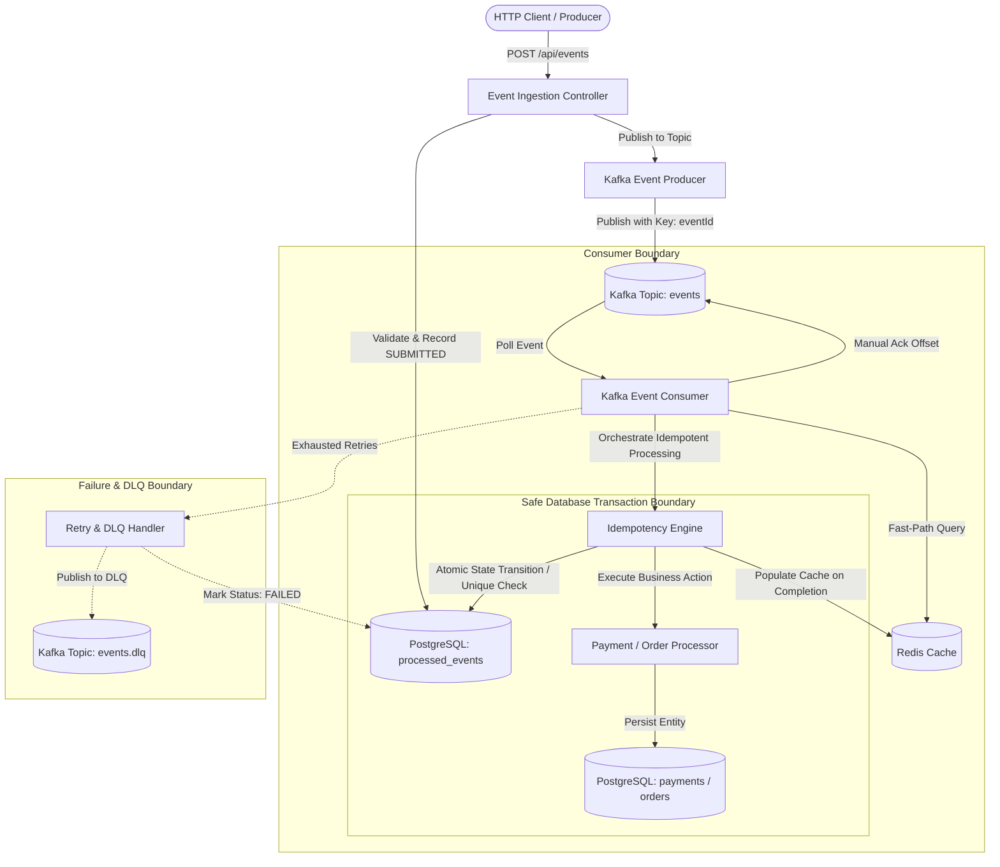
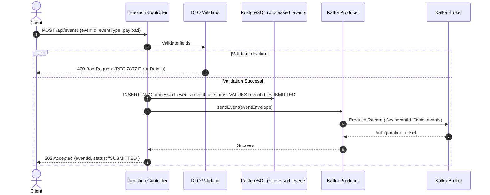
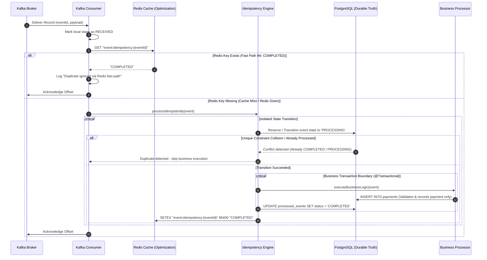
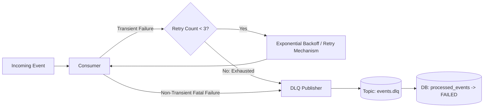

# Architecture Specification
## Idempotent Event Processing System

---

### 1. High-Level Architectural Overview

The **Idempotent Event Processing System** decouples HTTP ingestion from core business execution through an asynchronous event stream backed by Apache Kafka, a durable relational store (PostgreSQL), and a distributed fast-lookup cache (Redis).



---

### 2. Component Responsibilities

| Component | Responsibility | Failure Mode / Fallback |
| :--- | :--- | :--- |
| **Ingestion Controller** | Accepts REST payloads, performs Bean Validation, persists event as `SUBMITTED` in `processed_events`, and publishes to Kafka. Returns `202 Accepted`. | Returns `400 Bad Request` on validation failure; `503 Service Unavailable` if database or Kafka publish fails. |
| **Kafka Producer Service** | Publishes messages using `eventId` as the Kafka record key to provide partition affinity and preserve ordering for events sharing the same key. *Note:* Partition affinity does NOT guarantee idempotency; idempotency is guaranteed by PostgreSQL. | Synchronous delivery confirmation or callback logging. |
| **Kafka Consumer Service** | Listens to `events` topic using configured consumer groups. Manages manual offset acknowledgment (`AckMode.MANUAL_IMMEDIATE` or `RECORD`). | If fatal error, routes to retry mechanism or DLQ. |
| **Redis Cache Layer** | Provides a fast-path optimization for previously completed events (`eventId -> COMPLETED`) with a configurable TTL (e.g., 24 hours). *Redis is NOT the authoritative source of truth.* | If Redis is down, evicted, or returns a cache miss: logs a warning and gracefully proceeds directly to PostgreSQL. Idempotency is never compromised. |
| **Idempotency Engine** | Coordinates event lifecycle states and enforces PostgreSQL unique constraints. Eliminates naive `SELECT -> check -> INSERT` races using safe transactional boundaries. | Catches `DataIntegrityViolationException` in an isolated boundary; skips re-processing. |
| **Business Processor** | Implements the actual domain logic (e.g., `PaymentEventProcessor`). Validates payment payload, creates the payment record in PostgreSQL, and updates the event status to `COMPLETED` atomically. Does NOT update account balances or touch wallet tables. | Throws business/transient exceptions causing complete transaction rollback. |
| **PostgreSQL Database** | The ultimate, durable source of truth for both idempotency state (`processed_events`) and domain entities (`payments`). | ACID transactions guarantee atomicity between event status and business records. |
| **DLQ Publisher & Consumer** | Captures terminal event failures along with metadata (error message, headers, original payload), publishes to `events.dlq`, and records status as `FAILED`. | Retains poison pills for diagnostic inspection. |

---

### 3. Detailed Request & Processing Workflows

#### 3.1 Ingestion Flow (REST $\rightarrow$ Kafka)


---

#### 3.2 Consumption & Idempotent Processing Flow


---

### 4. Concurrency Handling & Idempotency Strategy

#### 4.1 Prohibition of Naive Check-Then-Act
In distributed systems, identical messages can be delivered in parallel across separate consumer threads or instances. 

> [!WARNING]
> **A naive `SELECT -> check -> INSERT` pattern is strictly forbidden.**
> If thread A and thread B both execute `SELECT` before either commits, both will conclude the event is unprocessed and both will execute the business logic, producing duplicate side effects.

#### 4.2 Safe Concurrency & Transaction Boundary Architecture
To eliminate race conditions without database transaction corruption:
1. **Durable Database Unique Constraint:**
   `processed_events` defines `CONSTRAINT uq_processed_events_event_id UNIQUE (event_id)`.
2. **Safe Transaction Isolation:**
   - Catching a `DataIntegrityViolationException` inside an active Spring `@Transactional` method marks that entire transaction as **rollback-only**. Blindly attempting further database queries in that same tainted transaction will result in `UnexpectedRollbackException`.
   - Therefore, the event reservation/state-transition is handled in an **isolated transactional boundary** (e.g., dedicated sub-transaction with `Propagation.REQUIRES_NEW` or explicit insert-first isolation).
   - If an insert or transition detects a unique constraint collision:
     - The isolated transaction safely rolls back without corrupting any outer flow.
     - The consumer inspects the existing event state.
     - If status is `COMPLETED` or `PROCESSING`, the consumer skips business execution and safely acknowledges the Kafka offset.
3. **Guarantees Enforced:**
   - **Exactly one successful business effect:** Only the thread that successfully transitions state to `PROCESSING` proceeds to business logic.
   - **Duplicate attempts do not execute the business effect:** Any competing thread halts immediately.
   - **PostgreSQL remains the final durable protection:** Even if Redis is entirely unavailable or flushed.
   - **No inconsistent state:** If the business operation fails, its transaction rolls back cleanly, leaving no orphan payment records.

---

### 5. Event Status State Machine & Lifecycle

The system tracks event progression using the following durable `EventStatus` values:

| Status | Meaning |
| :--- | :--- |
| `SUBMITTED` | The REST request was validated and the event was successfully published to Kafka. |
| `RECEIVED` | The Kafka consumer received the event from the broker. |
| `PROCESSING` | The event is actively being processed inside the business processing workflow. |
| `COMPLETED` | The business operation and corresponding event state were successfully committed. |
| `FAILED` | The event reached a terminal failure state and is routed to the DLQ. |

> [!IMPORTANT]
> `RETRYING` is **NOT** a durable PostgreSQL `EventStatus`. Kafka retry mechanisms represent retry attempts, and the retry count is stored in the `retry_count` column of `processed_events`.

---

### 6. Kafka Partition Key & Transport Guarantees

- **Partition Key:** `eventId` is set as the Kafka record key. This provides partition affinity and preserves ordering for messages sharing the same key.
- **Explicit Architectural Fact:** Kafka partitioning does **NOT** guarantee idempotency. In distributed deployments, partition rebalances, consumer crashes, and retry mechanisms mean multiple consumer instances can still receive duplicate messages. 
- The durable idempotency guarantee comes strictly from:
  $$\text{PostgreSQL Unique Constraint} + \text{Transactional Business Processing} + \text{Durable Event State}$$

---

### 7. Retry & Dead Letter Queue (DLQ) Architecture



- **Transient Errors:** (e.g., transient database lock acquisition timeout) $\rightarrow$ Retried up to 3 times via Kafka retry handler.
- **Non-Transient Errors:** (e.g., malformed payload, schema violation) $\rightarrow$ Immediately routed to `events.dlq` without futile retries.
- **DLQ Payload Enrichment:** Contains original payload, `X-Exception-Message`, `X-Exception-Stacktrace`, and `X-Retry-Count`. Event status in PostgreSQL is updated to `FAILED`.

---

### 8. Redis Fast-Path Optimization

- **Role:** Redis provides a fast-path optimization for previously completed events to minimize unnecessary database reads.
- **Authoritative Source:** Redis is **NOT** the authoritative idempotency mechanism; PostgreSQL remains the sole durable source of truth.
- **Outage Resilience:** If Redis fails, throws connection exceptions, or is flushed:
  - The system catches Lettuce/Redis exceptions, emits a warning log, and falls back to PostgreSQL seamlessly.
  - Idempotency guarantees are 100% preserved.

---

### 9. Project Structure

```
e:/New folder/
├── docs/
│   ├── prd.md
│   ├── architecture.md
│   ├── rules.md
│   ├── phases.md
│   └── design.md
├── pom.xml
└── src/
    ├── main/
    │   ├── java/com/example/eventprocessor/
    │   │   ├── EventProcessorApplication.java
    │   │   ├── config/
    │   │   │   ├── KafkaConfig.java
    │   │   │   ├── RedisConfig.java
    │   │   │   └── OpenApiConfig.java
    │   │   ├── controller/
    │   │   │   └── EventIngestionController.java
    │   │   ├── dto/
    │   │   │   ├── request/
    │   │   │   │   └── EventRequestDto.java
    │   │   │   └── response/
    │   │   │       ├── EventResponseDto.java
    │   │   │       ├── EventStatusResponseDto.java
    │   │   │       └── ErrorResponseDto.java
    │   │   ├── entity/
    │   │   │   ├── ProcessedEventEntity.java
    │   │   │   ├── PaymentEntity.java
    │   │   │   └── OrderEntity.java
    │   │   ├── repository/
    │   │   │   ├── ProcessedEventRepository.java
    │   │   │   ├── PaymentRepository.java
    │   │   │   └── OrderRepository.java
    │   │   ├── producer/
    │   │   │   └── KafkaEventProducer.java
    │   │   ├── consumer/
    │   │   │   ├── KafkaEventConsumer.java
    │   │   │   └── KafkaDlqConsumer.java
    │   │   ├── idempotency/
    │   │   │   ├── IdempotencyService.java
    │   │   │   ├── IdempotencyCacheService.java
    │   │   │   └── EventStatus.java
    │   │   ├── processing/
    │   │   │   ├── EventProcessorRegistry.java
    │   │   │   ├── BusinessEventProcessor.java
    │   │   │   ├── PaymentEventProcessor.java
    │   │   │   └── OrderEventProcessor.java
    │   │   └── exception/
    │   │       ├── GlobalExceptionHandler.java
    │   │       ├── DuplicateEventException.java
    │   │       ├── EventProcessingException.java
    │   │       └── InvalidEventPayloadException.java
    │   └── resources/
    │       ├── application.yml
    │       ├── application-docker.yml
    │       ├── application-test.yml
    │       └── db/migration/
    │           ├── V1__create_processed_events_table.sql
    │           ├── V2__create_payments_table.sql
    │           └── V3__create_orders_table.sql
    └── test/
        └── java/com/example/eventprocessor/
            ├── controller/EventIngestionControllerTest.java
            ├── idempotency/IdempotencyServiceTest.java
            ├── consumer/KafkaEventConsumerIntegrationTest.java
            ├── concurrency/ConcurrentDuplicateProcessingTest.java
            └── resilience/RedisFailureFallbackTest.java
```

---

### 10. Core Architectural Decisions (ADRs)

- **ADR-1: Dual-Layer Idempotency (PostgreSQL + Redis)**
  - *Decision:* Redis provides fast-path lookups for completed events; PostgreSQL unique constraint is the sole authoritative durable guarantee.
- **ADR-2: EventId as Kafka Record Key**
  - *Decision:* Set record key to `eventId` for partition affinity and per-event ordering. Partitioning is not the idempotency mechanism.
- **ADR-3: Flyway for Schema Versioning**
  - *Decision:* Flyway migrations manage exact indexes, constraints, and relational schemas.
- **ADR-4: Strategy Pattern for Event Types**
  - *Decision:* Implement `BusinessEventProcessor<T>` registry, adhering to Open-Closed Principle (OCP).
- **ADR-5: PAYMENT_COMPLETED Scope Limitation**
  - *Decision:* `PAYMENT_COMPLETED` records payments in `payments` and advances idempotency state. It does NOT manage account balances or create wallet/ledger tables.
