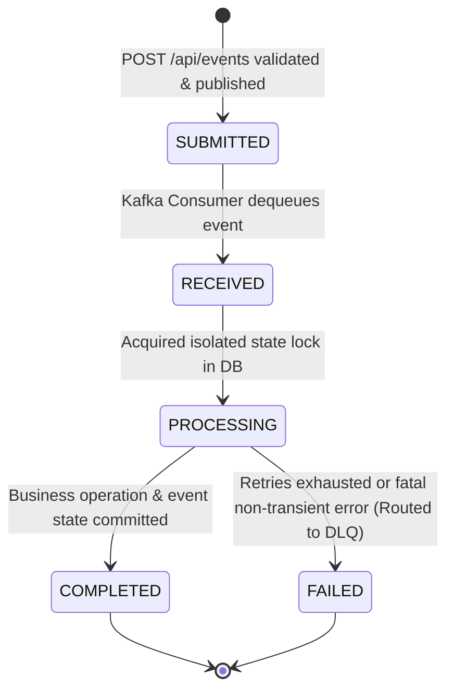

# Technical Design & Conventions
## Idempotent Event Processing System

---

### 1. Backend & API Design Principles

The API follows RESTful architectural constraints with enterprise-grade conventions:
- **Stateless Communication:** No server-side HTTP session state.
- **Resource Orientation:** Clear URI paths representing entities and resources (`/api/events`).
- **Standardized Status Codes:** Consistent semantics across ingestion, retrieval, and error scenarios.
- **Strict Input Validation:** Fail-fast validation with detailed feedback on malformed inputs.
- **Immutability:** API contracts are immutable data transfers utilizing Java 21 `record` types.

---

### 2. URI & Endpoint Conventions

All public endpoints are prefixed with `/api`.

| Method | Endpoint | Description | Success Code | Error Codes |
| :--- | :--- | :--- | :--- | :--- |
| `POST` | `/api/events` | Ingest an event into the system | `202 Accepted` | `400 Bad Request`, `503 Service Unavailable` |
| `GET` | `/api/events/{eventId}` | Query processing status & audit | `200 OK` | `404 Not Found`, `500 Internal Error` |
| `GET` | `/actuator/health` | Service liveness & readiness | `200 OK` | `503 Service Unavailable` |
| `GET` | `/actuator/metrics` | System and domain metrics | `200 OK` | `401/403` (if secured) |

---

### 3. JSON Payloads & Schema Conventions

#### 3.1 Ingestion Request Payload (`POST /api/events`)
```json
{
  "eventId": "EVT-1001-A",
  "eventType": "PAYMENT_COMPLETED",
  "payload": {
    "paymentId": "PAY-501",
    "userId": "USER-9921",
    "amount": 250.00,
    "currency": "USD"
  }
}
```

**Field Rules:**
- `eventId`: Mandatory, non-blank string (max 128 chars). Used as the global idempotency key and Kafka message record key.
- `eventType`: Mandatory, non-blank string matching a registered processor type (`PAYMENT_COMPLETED`, `ORDER_CREATED`).
- `payload`: Mandatory, non-empty JSON object containing event-specific attributes.
  - For `PAYMENT_COMPLETED`: `paymentId`, `userId`, `amount`, `currency`. (Note: The system does NOT manage account balances or wallet tables).
  - For `ORDER_CREATED`: `orderId`, `customerId`, `totalAmount`, `itemCount`.

#### 3.2 Ingestion Response Payload (`202 Accepted`)
```json
{
  "eventId": "EVT-1001-A",
  "status": "SUBMITTED",
  "message": "Event accepted and queued for asynchronous processing",
  "submittedAt": "2026-09-07T12:00:00.123Z"
}
```

#### 3.3 Event Status Query Response (`GET /api/events/{eventId}`)
```json
{
  "eventId": "EVT-1001-A",
  "eventType": "PAYMENT_COMPLETED",
  "status": "COMPLETED",
  "retryCount": 0,
  "errorMessage": null,
  "processedAt": "2026-09-07T12:00:01.450Z",
  "createdAt": "2026-09-07T12:00:00.120Z",
  "updatedAt": "2026-09-07T12:00:01.450Z"
}
```

---

### 4. Event Status Lifecycle & State Machine

The system uses the following durable `EventStatus` values in PostgreSQL:

- `SUBMITTED`: The REST request was validated and the event was successfully published to Kafka.
- `RECEIVED`: The Kafka consumer received the event from the broker.
- `PROCESSING`: The event is actively being processed inside the business processing workflow.
- `COMPLETED`: The business operation and corresponding event state were successfully committed.
- `FAILED`: The event reached a terminal failure state and is routed to the DLQ.



> [!IMPORTANT]
> **No RETRYING Status in PostgreSQL:**
> `RETRYING` is deliberately NOT an `EventStatus` value. Retry attempts are orchestrated dynamically by Kafka consumer retry mechanisms, and the attempt count is recorded in the `retry_count` integer column in `processed_events`.

---

### 5. Concurrency & Locking Design

#### 5.1 Prohibition of Naive Check-Then-Act
A naive `SELECT -> check -> INSERT` approach is strictly forbidden because concurrent consumer threads will both observe an absent record and concurrently proceed with duplicate business execution.

#### 5.2 Safe Transaction Boundaries
- Concurrent duplicate handling relies strictly on PostgreSQL's unique constraint (`uq_processed_events_event_id`) and a safe transaction boundary.
- **Rule on Exceptions:** Do not implement a `DataIntegrityViolationException` catch inside an active Spring `@Transactional` method and then blindly continue executing queries in that same rollback-only transaction.
- To maintain consistency:
  - Attempting to reserve an event or transition to `PROCESSING` is executed in an isolated sub-transaction boundary.
  - If a duplicate collision occurs, the isolated transaction rolls back cleanly. The consumer then reads the committed event state from PostgreSQL:
    - If `COMPLETED` or `PROCESSING`: skip business execution and acknowledge Kafka offset.
  - Only the winning thread executes the business transaction (`PaymentEventProcessor` + `COMPLETED` update).

---

### 6. Redis Fast-Path Conventions

- **Role:** Redis provides a fast-path optimization for previously completed events (`GET event:idempotency:{eventId}`).
- **Authoritative Invariant:** Redis is NOT the authoritative idempotency mechanism; PostgreSQL remains the durable source of truth.
- **Outage Resilience:** Redis loss, eviction, restart, or connection failure must never compromise idempotency. If Redis operations throw an exception or return a cache miss, the system transparently falls back to PostgreSQL.

---

### 7. Error Response Conventions (RFC 7807)

Errors return standard JSON adhering to RFC 7807 Problem Details:

```json
{
  "type": "https://api.eventprocessor.example.com/errors/validation-failed",
  "title": "Validation Failed",
  "status": 400,
  "detail": "Invalid request parameters in request body",
  "instance": "/api/events",
  "timestamp": "2026-09-07T12:00:00.000Z",
  "errors": [
    {
      "field": "eventId",
      "rejectedValue": "",
      "message": "eventId must not be blank"
    }
  ]
}
```

Internal exception details and stack traces are suppressed from client responses and logged solely in server logs.

---

### 8. Logging & Observability Conventions

#### 8.1 Mapped Diagnostic Context (MDC)
Every log statement within the event processing pipeline must include:
- `traceId`: Unique identifier for the HTTP request or Kafka message context.
- `eventId`: The idempotency key of the event being handled.
- `eventType`: The business classification (`PAYMENT_COMPLETED`, `ORDER_CREATED`).

#### 8.2 Standard Log Format
```
2026-09-07 12:00:01.125 [kafka-consumer-1] INFO  c.e.e.c.KafkaEventConsumer [traceId=tr-8812, eventId=EVT-1001-A, eventType=PAYMENT_COMPLETED] - Duplicate event detected via Redis fast-path. Skipping business execution.
```

---

### 9. Frontend Policy & UI Notice

This project is strictly a backend event-processing service. 
- No frontend code or web UI in initial releases.
- If an admin monitoring UI or DLQ explorer is introduced later, its visual design must be specified in a separate design document before any implementation begins.
